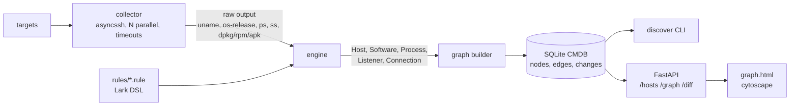
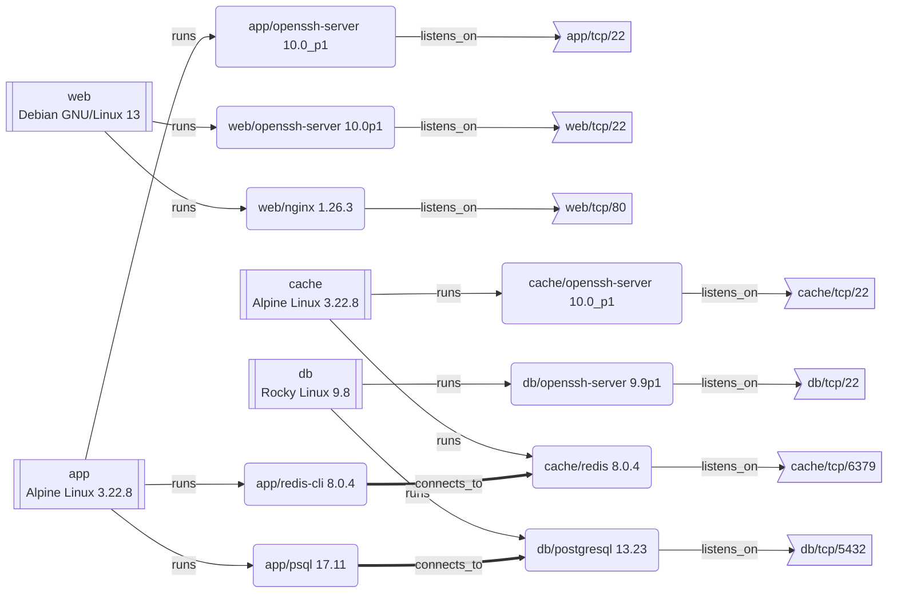

# infra-discovery

[](https://github.com/DYyyyDYyy/infra-discovery/actions/workflows/ci.yml)

Agentless software discovery in the spirit of BMC Discovery: log in to hosts over SSH, run read-only
commands, identify the OS, software, versions, listening ports and client→server dependencies with
TPL-like rules, and keep the result as a CMDB graph with change history.

```bash
make lab && make scan      # 4 containers (Debian, Rocky, Alpine x2), first scan
make scan-check            # second scan: must report "diff: no changes"
make serve                 # http://127.0.0.1:8000  graph page + REST API
```

Requirements: Docker, [uv](https://docs.astral.sh/uv/), make, `ssh-keygen`. No root, no cloud.

## Architecture



## What a lab scan finds

Output of `discover graph` after `make scan` (process nodes hidden), rendered by GitHub.
The same graph is interactive at `make serve`.



## Rules

A rule fires when all `when` conditions hold; `extract` takes regex group 1 (repeated extracts are
fallbacks, e.g. one per package format); `set` assigns constants.

```
rule postgresql {
    kind software
    when ps matches /postgres: checkpointer/
    set name = "postgresql"
    set process = "postgres"          # links the software to its process and sockets
    set ports = "5432"                # fallback when ss cannot see the socket owner
    extract version from packages regex /^postgresql\d*-server (\S+)/              # rpm
    extract version from packages regex /^postgresql-\d+ (?:\d+:)?([^-\s+]+)/      # dpkg
    extract version from packages regex /^postgresql\d+-(\d[^-\s]*)-r\d+$/        # apk
}
```

Sources: `uname`, `os_release`, `hostname`, `ip_addr`, `ps`, `ss`, `packages`. Errors point at the
spot: `demo.rule:1:31: unexpected 'maches', expected one of: 'matches', 'not'`.
Rule tests run against real output captured from the lab (`tests/fixtures`, refresh with
`discover scan ... --save-raw tests/fixtures`).

## CLI and API

| | |
|---|---|
| `discover scan HOST... --key K` | scan over SSH, reconcile into the CMDB, print the diff |
| `discover analyze raw/*.json` | same from saved raw output, no SSH |
| `discover diff [--from N --to M]` | changes between scans (default: the last one) |
| `discover graph [--format json]` | current graph as Mermaid or JSON |
| `discover serve` | `GET /hosts`, `/graph`, `/diff?from_scan=&to_scan=`, `/scans`, `/` |

Docker: `docker build -t infra-discovery .` then
`docker run --rm --network idlab -v ./lab/id_ed25519:/k/key:ro -v id-data:/data infra-discovery scan web db cache app --key /k/key`
(the key must be readable by the container user; on SELinux hosts add `,z` to the mount).

## How this maps to BMC Discovery

| BMC Discovery / Helix | here |
|---|---|
| Discovery run over **scan ranges** | `discover scan` targets |
| **Credentials** (SSH key / vault) | `--key`, user per target `user@host:port` |
| Discovery scripts / commands on host | `collector.COMMANDS` (read-only) |
| **DDD** (Directly Discovered Data) | `RawScan` JSON (`--save-raw`) |
| **Patterns** written in **TPL** | `rules/*.rule` in the Lark DSL |
| Host, Software Instance, Process, Listening Port | `host`, `software`, `process`, `listener` nodes |
| Dependency / communication mapping | `connects_to` edges from established `ss` sockets |
| CMDB sync and change history | SQLite `nodes`/`edges` + `changes`, `discover diff` |

Not covered: Windows (WMI/PowerShell), SNMP devices, credential vault, privileged commands, a TPL
`triggers`/`pattern` hierarchy. See [docs/adr](docs/adr) for the design decisions.

## Development

`make test` (pytest + hypothesis, coverage gate 80%), `make lint` (ruff, mypy --strict),
`make lab-down` to remove the lab. CI runs lint, tests, the Docker build and a real lab scan.
